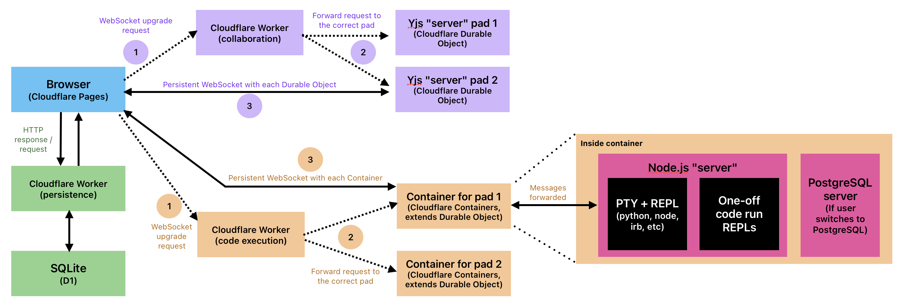

# Architecture

This document describes, in more depth, the production system design of The SPOT Editor: how the pieces fit together, why they are separate, and the tradeoffs behind the main technology choices.

The first version of this app ran locally: Vite + a `y-websocket` Node server, a Flask API over PostgreSQL, and a Node execution server that orchestrated Docker containers with Dockerode. Production keeps the same four-layer shape (frontend, collaboration, persistence, execution) and moves each layer onto Cloudflare. The local `apis/` directory you'll see in the `development` branch is the prototype; `workers/` is what serves real traffic from the `main` branch.

> This document is a deeper technical companion to the [Whitepaper](WHITEPAPER.md), which covers the project's motivation and higher-level design rationale.

---

## Table of Contents

- [System Overview](#system-overview)
- [Component Breakdown](#component-breakdown)
  - [Frontend](#frontend)
  - [Collaboration Layer](#collaboration-layer)
  - [Persistence Layer](#persistence-layer)
  - [Code Execution Layer](#code-execution-layer)
- [Data Model](#data-model)
- [Session Generations](#session-generations)
- [Key Design Decisions](#key-design-decisions)
- [Roadmap](#roadmap)

---

## System Overview

What travels where:

- **Inside the browser, Monaco is bound to Yjs via `MonacoBinding`.** Keystrokes go Monaco → `Y.Text` → `y-partyserver` provider → the pad's Durable Object. The same `Y.Doc` also has a `Y.Map` whose `language` key syncs the dropdown across users.
- **The browser terminal is xterm.js.** It opens a second WebSocket to the execution Worker. That Worker does not run the REPL itself; it forwards the connection to the pad's Container.
- **Persistence is ordinary HTTP.** Debounced saves, language changes, and last-user-leave writes go to the Hono Worker, which reads and writes D1. This API does not know about Yjs or terminals.

The three Workers share one D1 database (`collab-pads`). Persistence owns pad content. Collaboration and execution use D1 only to check that a pad exists and to read/write the current **generation ID** (see [Session Generations](#session-generations)).

---

## Component Breakdown

### Frontend

**Built with:** Vite + vanilla JavaScript, hosted on Cloudflare Pages  
**Entry point:** `index.html` → `src/js/main.js`

`main.js` is the orchestrator: it initializes each module, wires event listeners, and sequences async work that has to happen in order (name modal before Monaco, look up latest pad language before WebSocket setups, Yjs sync before seeding content).

This is not a routed SPA. Pages serves the same `index.html` for every `/pads/:id` URL. The client reads the pad ID from `window.location.pathname` and connects to the matching rooms. Unknown IDs get a 404 from the persistence API, and the client sends the user to `invalid.html`.

| Module | Responsibility |
|---|---|
| `editor.js` | Monaco instance and per-language models |
| `collaboration.js` | `Y.Doc`, `y-partyserver` provider, awareness, `MonacoBinding` lifecycle, 20s heartbeat ping |
| `persistence.js` | Thin REST client - `GET` / `PATCH` against the persistence Worker |
| `output.js` | HTML preview pane (sandboxed iframe) |
| `resizer.js` | Draggable divider and associated math, 150 px minimum pane width |
| `modal.js` | Name prompt, shown on first visit per browser |
| `username.js` | Validation helpers shared by the modal and inline name editing |
| `terminal.js` | xterm.js UI, execution WebSocket, 30s heartbeat, and reconnect on unexpected close |

**Startup order matters.** `main.js` opens the collaboration socket *before* the terminal socket. The collaboration Worker is the only thing that creates a pad's generation ID, and the execution Worker only joins a session that already exists (see [Session Generations](#session-generations)).

**Saving on leave is guarded.** `lastUserUnload` only writes to D1 when this tab has finished its initial sync (`initialSyncComplete`, set at the end of `onFirstSyncLogic`) *and* the provider is currently `synced`. "I am the only user" can also mean "I haven't heard from anyone yet" (page left mid-load) or "my socket dropped" (the provider clears remote awareness on disconnect). In either case the local editor may be empty or stale, and saving it would overwrite good data.

**Monaco web workers.** Monaco offloads syntax analysis, JS/TS IntelliSense, and formatting to web workers so typing stays responsive. `MonacoEnvironment.getWorker` in `editor.js` picks a JavaScript worker, an HTML worker, or the generic editor worker.

---

### Collaboration Layer

**Built with:** Yjs, y-partyserver / partyserver, y-monaco  
**Worker:** `workers/collaboration/`  
**Frontend class:** `ConnectionManager` in `collaboration.js`

`y-websocket` is a Node library. Cloudflare Durable Objects run in V8 isolates, not Node, so the production server is PartyKit's `YServer` (Cloudflare acquired PartyKit in 2024) rather than our own Yjs server.

**Request path**

1. The browser opens a WebSocket to the collaboration Worker with a PartyKit room name `room-<padId>`.
2. The Worker checks `COLLAB_LOCATION_LIMITER`, then `COLLAB_IP_LIMITER` (see [Rate limiting](#rate-limiting-1) below), then extracts the pad ID and rejects unknown pads.
3. It checks `COLLAB_PAD_LIMITER`, now that the pad is confirmed to exist, then loads or creates a generation ID.
4. It records `(padId, generationId, connectionId)` in `pad_connections` and only increments `join_count` if that row is new - `connectionId` is the `_pk` query param `y-partyserver`'s `YProvider` sends on every connect *and* reconnect, so PartySocket reconnects (network blips) within the same generation reuse the same ID and are not double-counted (see [Data Model](#data-model)).
5. It rewrites the path to `room-<padId>-<generationId>` and hands the request to `routePartykitRequest`, which routes to the Durable Object for that room.

**Inside the Durable Object**

`MyYServer` extends `YServer`. PartyKit handles the WebSocket, Yjs binary sync, awareness, and the in-memory `Y.Doc`. When the last client disconnects, the object schedules a Durable Object **alarm** for 20 seconds later instead of clearing state immediately. `alarm()` always re-counts the open sockets itself, so an alarm left over from before someone reconnected does nothing harmful, and `onConnect` does not need to cancel it. If the room is still empty when `alarm()` runs, the object:

- Clears the pad's generation ID in D1, so the next group gets a new object. The `UPDATE` is conditioned on `generation = <this room's generation>`, so an old room can never wipe a newer live one.
- Deletes Durable Object storage (including any alarm) so generation-scoped objects do not accumulate forever

`alarm()` runs that cleanup inside `blockConcurrencyWhile` so a D1 write cannot interleave with a new `onConnect`. If the D1 write fails, the alarm is re-armed (30 s) and storage is kept, so the clear is retried instead of lost.

**Noticing dead sockets.** Clearing the generation depends on the room *knowing* it is empty, and that is less reliable than it sounds. A close that leaves other sockets behind never triggers the cleanup, and a socket whose client vanished (closed laptop, dropped Wi-Fi) may never produce a close event at all. If the room kept counting such a socket, the generation would stay set and the pad's container would keep running. Three pieces work together to prevent that:

- **Recheck alarm.** Whenever the room has sockets, one alarm stays pending (every 60 s). If `alarm()` finds sockets still open it schedules the next check. Once the count reaches zero, it clears the generation as above. `ensureCleanupCheckScheduled` never pushes back an alarm that is already pending.
- **Heartbeat.** `y-partyserver` sends nothing while the editor is idle, so a dead connection looks the same as a quiet one. The client (`ConnectionManager`) sends the text `ping` every 20 s and right after each (re)connect. The Durable Object registers `setWebSocketAutoResponse("ping" → "pong")` in its constructor (it has to be set on every wake-up), so Cloudflare answers without waking a hibernating object and records the time per socket (`getWebSocketAutoResponseTimestamp`). The recheck alarm closes any socket with no ping for 3 minutes (close code `4003`), using the connect time for a socket that never pinged. Sockets opened before this code existed have no recorded connect time and are treated as just seen. Clients that predate the heartbeat don't ping, so they are recycled about every 3 minutes until they refresh (they reconnect on their own). The 3-minute timeout sits well above the 20 s ping interval because browsers throttle timers in background tabs to roughly once a minute. If closing idle sockets empties the room, the usual 20 s grace period applies before the generation is cleared.
- **Reconnects replace the old socket.** A reconnecting client reuses its `_pk` (the connection ID), but the server can hold on to that client's previous socket for minutes. `onConnect` tags each new socket with a random token and closes any older socket with the same connection ID (close code `4001`), so ghost sockets don't inflate the count or keep the room alive.

Because a dead client never answers a close frame, the platform's own `onClose` for an evicted socket can arrive many minutes late, by which point a reconnected client may be using the same Yjs client ID. So when `MyYServer` closes a socket itself (replaced or idle), it removes that socket's awareness state immediately (`retireSocket`) and marks the socket as retired. The late `onClose` skips the awareness removal for retired sockets so it cannot delete a newer socket's state.

**Logging and sanity checks.** The Worker logs `join` (with new vs reconnect), and the Durable Object logs `onConnect`, `onClose` (connection ID, close code, socket count), `closing idle socket`, and `alarm cleared`, which is what makes the lifecycle above debuggable in production. `onSave` (debounced by `y-partyserver`) also warns once per room if a `\r` ever appears in a shared `monaco-*` text. Clients force Monaco to `\n` line endings, so a `\r` means an out-of-date client or a new bug is putting 2-character line breaks into the document, which would throw off every other user's edits and cursor positions.

Hibernation is **on** (`static options = { hibernate: true }`). After about 10 seconds with no messages, Cloudflare evicts the Durable Object from memory. The WebSockets stay connected. The next message, or a new joiner, wakes the object, and both the in-memory `Y.Doc` and the awareness map start empty.

`y-partyserver` already refills the document. On wake, `onStart` sends sync step 1, which means "this document is empty; send what I am missing." Connected browsers reply with the code, and the server's `Y.Doc` is restored. Awareness is a separate channel (names, colors, cursors), and `y-partyserver` does not ask for it. `MyYServer` sends Yjs query message `3` from `onStart` and again from `onConnect`. Each connected browser answers with its own awareness, and the server forwards those updates. `onConnect` repeats the query because the joiner who woke the object is not in the connection list yet while `onStart` runs. Without that second query, a browser that joins after the room has slept would not see who is already there until someone moved or edited.

**Document shape (browser)**

Each client holds one `Y.Doc`:

- **One `Y.Text` per language** (`monaco-python`, `monaco-javascript`, …), each bound to a Monaco model via `MonacoBinding`. Switching languages swaps the active model; it does not wipe the previous language's text.
- **One `Y.Map`** with a `language` key, so a dropdown change is shared.

**Awareness** carries ephemeral state that should not be persisted: display name and cursor color. Presence lives only in memory on the Durable Object. Hibernation clears it while clients are still connected; the query above is what brings it back. When everyone leaves, it is gone, which is what we want.

**Rate limiting:** a WebSocket only passes through the Worker's `fetch` handler once, at the upgrade request - every message after that is a Durable Object event handled by PartyKit, not something that comes back through the Worker. So, like execution, new connection attempts are throttled in `src/index.js` before any D1 access or Durable Object routing: `COLLAB_LOCATION_LIMITER` (40/min, constant key `"all"`) caps every client at one Cloudflare location together, which is what stops many IPs from scanning pad IDs at that location; `COLLAB_IP_LIMITER` (10/min, keyed on `cf-connecting-ip`) catches one source opening connections across many pads; `COLLAB_PAD_LIMITER` (25/min, keyed on `padId`, checked only once the pad is confirmed to exist) catches repeated connection churn against one pad regardless of source. All three are "simple" Workers Rate Limiting bindings (per Cloudflare location, not global). The constant key works because the binding already keeps a separate counter at each location. They mirror `EXEC_LOCATION_LIMITER` / `EXEC_IP_LIMITER` / `EXEC_PAD_LIMITER` below.

---

### Persistence Layer

**Built with:** Hono on a Cloudflare Worker, D1 (SQLite)  
**Location:** `workers/persistence/`  
**Frontend module:** `src/js/persistence.js`

A stateless REST API. It does not know about Yjs, rooms, or users. Its job is durable storage.

| Method | Path | Purpose |
|---|---|---|
| `POST` | `/api/pads` | Create a pad (auth-gated) |
| `GET` | `/api/pads/:padId` | Current language |
| `PATCH` | `/api/pads/:padId` | Update current language |
| `GET` | `/api/pads/:padId/content/:language` | Saved content for a pad/language pair |
| `PATCH` | `/api/pads/:padId/content/:language` | Save content for a pad/language pair |
| `GET` | `/api/pads/:padId/generation` | Get or create the live generation ID |
| `DELETE` | `/api/pads/:padId/generation` | Clear the generation ID |

The collaboration and execution Workers currently talk to D1 **directly** for pad existence and generation IDs, rather than calling these last two HTTP endpoints. This is the preferred behavior for communication between two Cloudflare resources, as it is much quicker than going through multiple hops through the persistence Worker and API. The endpoints exist on the persistence Worker as well in case they are ever needed.

Pad IDs are 8-character nanoid strings using the same alphabet as the original Python `shortuuid` generator. Create is the only authenticated route (`Authorization: Bearer <AUTH_TOKEN>`). CORS is locked to `FRONTEND_URL`.

Pad creation is the only authenticated route (`Authorization: Bearer <AUTH_TOKEN>`). Every persistence route is also capped at 200 requests per minute for all clients at one Cloudflare location (`LOCATION_LIMITER`, constant key) and 600 requests per minute per client IP (`IP_LIMITER`); both counts are per Cloudflare location. The location cap is higher than the WebSocket workers' because content saves run on a 3-second debounce, and 200 requests covers about two groups of 3–5 people typing at that location. CORS is locked to FRONTEND_URL. Collaboration and execution are not covered by these caps- each has its own, separate connection-attempt rate limiting instead (see the "Rate limiting" notes under [Collaboration Layer](#collaboration-layer) above and [Code Execution Layer](#code-execution-layer) below), since a WebSocket upgrade is a much more expensive, longer-lived request than a stateless REST call.

See [`workers/persistence/README.md`](workers/persistence/README.md) for setup, tests, and the full API reference.

---

### Code Execution Layer

**Built with:** Cloudflare Worker + Container (Durable Object), Node.js, `ws`, `node-pty`  
**Worker:** `workers/execution/`  
**In-container code:** `workers/execution/container/`  
**Frontend module:** `src/js/terminal.js`

This is a second WebSocket, independent of Yjs. Each client connects with `padId` and `language` as query parameters.

**Request path**

1. The browser opens a WebSocket to the execution Worker.
2. The Worker checks the pad exists and **reads** the generation ID the collaboration Worker created. It never creates one itself. The browser opens both sockets at nearly the same time, so on a pad's first join the execution request can arrive a moment early. The Worker therefore polls D1 for up to about 2.5 s (10 tries, 250 ms apart). If no generation has appeared, it returns `503 Session not ready, please retry`, and the browser treats that like any failed connection and retries (see [Session Generations](#session-generations) for why).
3. Cloudflare starts (or reuses) that pad's container based on the pad ID and generation ID. The Container class proxies the WebSocket to the Node server listening on port 8080 inside the image.

The Worker is the receptionist. The container is the room.

**Inside the container**

Cloudflare Containers do not expose Dockerode's `exec` + `Tty: true` API, and the Sandbox SDK was still in preview when this was built (and would not have let us run our own Postgres code and server). The image therefore starts a Node server instead. Instead of having one Node server that manages multiple containers, each container now starts its own Node server.

| Piece | Role |
|---|---|
| `ReplServer` | Handles Cloudflare HTTP `/ping` plus a `ws` server. One process = one pad, so there is a single `PadSession` object, not a map of pad IDs. |
| `PadSession` | Shared terminal output log, current PTY, optional one-off run, Postgres-started flag, broadcast logic to all connected sockets. |
| `PtyManager` | `node-pty` for both the REPL and one-off runs; `child_process.exec` / `execSync` for Postgres startup. |

Cloudflare starts and stops the VM. We do not create, start, or kill containers ourselves. First-joiner setup solves for a race condition where two sockets can arrive before `this.session` exists, so setup creates a shared Promise instead that concurrent joiners await.

**The REPL:** For non-HTML languages, `node-pty` spawns the runtime (`python3`, `node`, `irb`, `ts-node`, or `psql`) as the unprivileged `sandbox` user. Frontend keystrokes arrive and are written to the PTY. PTY output is broadcast to every client in the pad. Because the REPL echoes input, everyone sees typing without a separate input broadcast. Every PTY spawned by `PtyManager` - the REPL and each one-off run - uses the same fixed size, `PTY_W` × `PTY_H` (80 columns × 40 rows); see [Fixed PTY dimensions](#fixed-pty-dimensions-not-a-per-client-resize) below.

**Run:** The Run button does **not** feed code into the REPL's PTY. `PtyManager` `#oneOffExecuteCode` spawns a second, disposable PTY- same `node-pty` call as the REPL, just with the language's non-interactive form (`python3 -c`, `node -e`, …) instead of the REPL command. It is killed once the run ends. Limits per run:

- **Timeout:** 15 seconds
- **Output cap:** 512 KB of incremental output

REPL output is suppressed for the duration of the run so PTY echo does not interleave with the one-off output. This used to be a plain `child_process.spawn` with stdin closed and stdout/stderr piped, which is simpler and needs no pty allocation. It broke down because stdout and stderr are two independent pipes: reading them separately meant interleaved writes to both could reach the client out of order. A PTY has a single file descriptor, so everything a process writes lands on it in the order the kernel actually saw it, which is why one-off runs moved onto `node-pty` too — see [A PTY for Run, not a pipe](#a-pty-for-run-not-a-pipe) below.

Because the one-off process is a real PTY, it can receive input the same way the REPL does. `PadSession`'s `#handleInput` routes typed keystrokes to whichever PTY is currently live, either the run's REPL, if one is in progress, or the main REPL's otherwise, so Python's `input()` or Ruby's `gets` inside a Run can be answered live.

**Language switch:** Receiving a `languageChange` message kills the current PTY and starts a new one in the same container. HTML starts no PTY. Output log is cleared.

**SQL:** Postgres is not running at container start. When a user switches the language to SQL, we start the Postgres server, wait until the server is ready, and then creates a `studentdb` database owned by the `student` role. This startup only happens upon the first language change trigger, and future language switches back to SQL skip startup. The image disables TCP listen, SSL, and `/dev/shm`-backed DSM (`dynamic_shared_memory_type = mmap`) because Cloudflare Containers do not provide a usable `/dev/shm`.

**Idle teardown:** A Container's `sleepAfter` timer (here `"20s"`) starts only after **all WebSockets are closed**. A forgotten background tab would keep the VM - and the bill - alive. `ReplServer` therefore closes every socket after **25 minutes with no REPL WebSocket message** (`input`, `run`, `languageChange`, `reset`, `stop`). Heartbeat `{ type: 'ping' }` frames keep the Cloudflare/NAT path alive but do **not** reset that timer. Idle closes use WebSocket code `4000` so the client does not auto-reconnect. Last socket close keeps the in-memory `PadSession` so a blip can reuse the same PTY; `SIGTERM` / `SIGINT` (from `sleepAfter` or Ctrl+C) tear the session down and let Node exit. `onStop` on the Durable Object deletes its SQLite storage so generation-scoped objects do not pile up.

**Silent-socket teardown:** The idle timer above only fires for sockets that are still connected. If a client disappears without its close ever reaching the container (browser tears the page down mid-handshake, lost network, sleeping laptop), the container keeps counting that socket as connected, and `sleepAfter` never starts. `ReplServer` therefore stamps `lastHeardAt` on every socket at connect and on every message, **pings included**, and a sweep every 30 s calls `terminate()` on any socket silent for 2.5 minutes. `terminate()` drops the connection without waiting for a close handshake the other side will never answer, then emits `close`, which lets the connection count reach zero. The sweep timer is `unref`'d so it never keeps the process alive on its own. This is deliberately separate from the 25-minute timer: that one measures real activity (pings excluded), while this one measures whether the client is still there at all (pings included).

The execution client (`terminal.js`) sends a ping every 30 seconds while the socket is open, comfortably under the 2.5-minute silence limit even with background-tab timer throttling. Unexpected closes retry up to three times; tab close and idle (`4000`) do not.

**Concurrency:** `wrangler.jsonc` sets `max_instances: 20` and `instance_type: "lite"`. Combined with fixed (auth-created) pad IDs, that keeps a refresh loop from exhausting the account's container slots.

**Rate limiting:** happens in two places, because a WebSocket only passes through the Worker's `fetch` handler once, at the upgrade request. Every message after that goes straight to the container and never comes back through the Worker.

- *Tier 1 (Worker, `src/index.js`):* Three Workers Rate Limiting bindings guard new connection attempts, i.e. new container starts, before `getContainer(...).fetch(request)` runs. `EXEC_LOCATION_LIMITER` (40/min, constant key `"all"`) caps every client at one Cloudflare location together; `EXEC_IP_LIMITER` (10/min, keyed on `cf-connecting-ip`) catches one source opening connections across many pads; `EXEC_PAD_LIMITER` (25/min, keyed on `padId`, checked only once the pad is confirmed to exist) catches repeated connection churn against one pad regardless of source. All three are "simple" bindings, so each count is per Cloudflare location, not global- see [Session Generations](#session-generations) for why a pad's traffic can legitimately span several locations. The constant key works because the binding already keeps a separate counter at each location.
- *Tier 2 (container, `container/server.js` + `container/rateLimiter.js`):* A small in-memory sliding-window limiter bounds how often an already-connected socket can send each message type. `input`/`ping`/`stop` are budgeted per socket (cheap, personal actions). `run`/`reset`/`languageChange` are budgeted per `PadSession` instead, shared across every client in the pad, because those kill or spawn PTY processes that every connected student feels, so a bot can't just open more sockets to the same pad to multiply its allowance. `handleRunEditorCode` also refuses a new run outright while one is already in flight, closing off a loop of instantly-failing runs that would otherwise spawn processes faster than the 15s timeout could bound them. A socket that keeps tripping any limit (`MAX_RATE_VIOLATIONS`) is disconnected with close code `4000 + 2 = 4002`, which the client (`terminal.js`) treats like the idle close code: no auto-reconnect.

**Security:** Cloudflare isolates containers (gVisor / microVMs); we do not run gVisor ourselves. On top of that:

| Constraint | How |
|---|---|
| Network | `enableInternet = false` on the Container class |
| User code | PTY and one-off processes run as `sandbox` (non-root) via `node-pty` / `spawn` `uid` |
| Run limits | 15 s timeout, 512 KB output, process-group kill on stop |
| Fork bombs | `prlimit --nproc=50` wraps every `sandbox`-user spawn (`PtyManager#withProcessLimit`), capping total concurrent processes for that user |

The development prototype (Dockerode) set this via `HostConfig.PidsLimit`, a cgroups control Cloudflare Containers does not expose through `wrangler.jsonc` — the `containers` config schema only covers `instance_type`, `max_instances`, `scheduling_policy`, and image/env settings, with no raw OCI runtime flags. `prlimit` recovers the same guarantee from inside the image: it sets `RLIMIT_NPROC` on itself and then `exec`s the target command (REPL or one-off run), so the limit is inherited without changing the resulting process's PID, and `#killProcessAndGroup` still works unmodified.

---

## Data Model

Three tables in D1 (SQLite). Timestamps are stored as `text` (`CURRENT_TIMESTAMP` / ISO-like strings) because D1 has no `timestamptz`.

### `pads`

| Column | Type | Notes |
|---|---|---|
| `id` | `text` (PK) | 8-character nanoid |
| `current_language` | `text` | Not null, check-constrained to the six supported languages |
| `generation` | `text` | Live session ID, or `NULL` when no group is in the pad |
| `join_count` | `integer` | Default 0, incremented on each new connection per generation - see `pad_connections` below |
| `created_at` | `text` | Set on insert |
| `updated_at` | `text` | Updated on language change, generation ID change, join count change |

### `pad_contents`

| Column | Type | Notes |
|---|---|---|
| `id` | `integer` (PK) | Surrogate key |
| `pad_id` | `text` (FK → `pads.id`) | Not null, cascading delete |
| `language` | `text` | Not null, check-constrained to the six supported languages |
| `content` | `text` | Nullable if no content yet for this language |
| `updated_at` | `text` | Updated on each save |

`UNIQUE (pad_id, language)` ensures at most one content row per pair. A row is created on first access for that pad/language, not at pad creation, so the table stays sparse. One pad can have up to six content rows for each unique language.

### `pad_connections`

| Column | Type | Notes |
|---|---|---|
| `pad_id` | `text` (PK, FK → `pads.id`) | Cascading delete |
| `generation_id` | `text` (PK) | The generation this connection was made during |
| `connection_id` | `text` (PK) | The `_pk` value `YProvider` sends; stable across reconnects, new on a fresh page load |
| `first_seen_at` | `text` | Set on insert |

Exists to dedup `join_count`: a naive "increment on every WebSocket connect" counts PartySocket's own reconnect attempts (network blips, idle-container refreshes) as brand-new joins, not just genuine new participants. `generation_id` is a fresh UUID per live session, so old rows never collide with a new generation's - rows are kept indefinitely rather than cleaned up, in case they're useful for later analysis (e.g. unique participants per generation).

This does not catch every duplicate - a full page refresh mid-session gets a new `connection_id` and is counted again - but that was an accepted tradeoff over adding client-side persistence (e.g. `sessionStorage`) for a metric that is directional, not billing-critical.

---

## Session Generations

Durable Objects (and Containers, which extend them) are addressed by ID. If that ID is only the pad ID, Cloudflare places the object near the **first user who ever opened that pad**, and it stays there.

This behavior is not ideal for our use case. Study groups are not always between students who are located in the same place. A US group on Monday and a European group on Tuesday should not both pay the latency of a Durable Object that happens to live in Virginia.

To solve for this, we generate a separate ID, called a "generation ID" to append onto the pad ID, which essentially forces Cloudflare to create a new Durable Object in a more guaranteed advantageous location for the students using the pad for that study session.

The routing key is `padId + generationId`:

1. First joiner of a quiet pad: the **collaboration** Worker runs `UPDATE pads SET generation = ? WHERE id = ? AND generation IS NULL`, then `SELECT generation`. The `WHERE generation IS NULL` clause is the race control- two simultaneous first joiners share one ID instead of each writing their own.
2. Collaboration rewrites the PartyKit room to `room-<padId>-<generationId>`. Execution **reads** the same D1 column (polling briefly if the collaboration Worker hasn't written it yet) and looks up `getContainer(..., "<padId>-<generationId>")`.
3. When the last Yjs client disconnects, collaboration waits **20 seconds** (Durable Object alarm). A reconnect in that window keeps the same generation. If the room is still empty, it sets `generation` back to `NULL`, but only if the pad is still on *that room's* generation. The next group gets a new UUID and a new object, placed near the user who joins first next time.

**One owner for the lifecycle.** Only the collaboration Worker creates a generation, and only its Durable Object clears it. Execution used to create one too, if it found none. That broke the invariant that every generation has a collaboration room that will eventually clear it: a generation created by an execution request alone (for example, a late terminal reconnect after the room had just emptied and cleared) had no room to clear it, so the pad stayed "live" and the container kept running. Making execution read-only removes that case, at the cost of the short poll and `503` retry described above.

This is also why Durable Object storage is deleted on close/stop: generations are meant to be ephemeral. Pad *content* lives in D1, not in the object.

Containers don't have this same issue, as Cloudflare notes in its documentation that Cloudflare will try to find the nearest "free" instance of the Container and start an instance there, provided the container wasn't in use prior to the new incoming request. This means that Container instances have the ability to relocate. 

We may not need generation IDs at some point in the future as Cloudflare notes it is working on dynamic relocation of existing Durable Objects.

---

## Key Design Decisions

### Monaco Editor

**Chosen over:** CodeMirror

Monaco matches what students already see in VS Code and ships JS/TS IntelliSense without extra setup. The cost is bundle size. Vite's worker configuration and code splitting help, but Monaco is still large. For a tool that occupies a dedicated tab, that tradeoff is acceptable.

---

### CRDTs and Yjs

When two users type at the same position, local documents diverge. Two mainstream approaches:

- **Operational Transformation (OT)** - Google Docs. A central server imposes a total order and transforms operations. Correct OT is famously hard to implement.
- **CRDTs** - Yjs, Automerge, and others. Replicas merge to the same result regardless of arrival order. The merge logic does not need a primary.

Yjs was chosen because it is a mature CRDT, it binds to Monaco via `y-monaco`, and awareness (cursors, names, colors) is built in. We did not implement YATA ourselves.

**YATA, short version:** the document is a linked list of items. Each item stores a unique ID (client ID + logical clock) and its left/right origins at insert time, not an absolute index. Simultaneous inserts at the same position sort deterministically by client ID. Deletes become tombstones so later inserts relative to deleted characters still resolve.

The server still exists - it relays updates and holds the in-memory doc for the live session - but it does not transform operations.

---

### Per-language `Y.Text` plus a `Y.Map` for the dropdown

Switching Python → JavaScript must not wipe the Python buffer. Each language is its own `Y.Text` inside one `Y.Doc`, plus a matching Monaco model and a cached `MonacoBinding`. The active language is a `Y.Map` value: it needs to sync, but it is not collaborative text.

Terminal output used to be a candidate for that map. It now lives only on the execution server (broadcast + replay). Mixing REPL bytes into the CRDT was the wrong owner.

---

### Debounced saves, local edits only

Content is written to D1:

1. When the last user leaves (`beforeunload` + `fetch` with `keepalive: true`)
2. When anyone changes language (save the old language first)
3. While typing, on a **3-second debounce**

Saves are skipped for remote Yjs transactions (`transaction.local === false`), so N users do not write the same bytes N times. A crash can lose at most ~3 seconds of work, not a whole interval-based window.

The last-user-leaves save is the one write that replaces stored content with whatever this tab holds, so it is guarded: it only runs if the tab has completed its initial sync and the provider is currently synced. Otherwise a tab that left mid-load, or one whose socket had silently dropped, could believe it was alone and overwrite good data with an empty or stale editor.

`beforeunload` is unreliable for async work. `keepalive: true` asks the browser to finish the `PATCH` after the page is gone. `navigator.sendBeacon` cannot send a JSON `PATCH`.

---

### First user in the room

The first client must seed the `Y.Doc` from D1. Everyone else must **not**, or they would clobber in-progress work with whatever was last saved.

The check is `users.length <= 1` after the Yjs `sync` event. That creates a cycle: we need a language to initialize the editor, but `Y.Map['language']` is not trustworthy until after sync. Every client therefore fetches the pad's current language over HTTP first (cheap, and it also 404s invalid IDs). Only the first user then writes that language and content into Yjs; others take the synced doc.

---

### Two WebSocket connections

Yjs wants opaque binary updates and awareness. The execution path wants raw terminal I/O, PTY lifecycle, and one-off processes. Those are different servers, different failure domains, and different scaling units and thus deserve separate connections. Restarting a container should not drop editor sync.

---

### Cloudflare everywhere, rather than a hybrid

The prototype could have gone to production as "Pages + Durable Objects for Yjs, and AWS for the rest." One platform won because the three backend pieces have to share identity (pad IDs, generation IDs, CORS, deploy story) and because Cloudflare already had a container product that extends Durable Objects- the same "one object per pad" model as collaboration.

---

### Collaboration - Durable Objects vs a self-hosted WebSocket server vs AWS API Gateway

**Self-hosted Node (Railway, a Lightsail box, etc.):** Fast to stand up. You operate a process, you pick a region, and distant students pay public-internet RTT to that region. One process also multiplexes every pad. This also means we have to maintain a server.

**API Gateway WebSockets + Lambda:** Request/response oriented. Yjs needs a long-lived in-memory room. Recreating that room on every invocation is a lot of machinery for a worse fit.

**Workers + Durable Objects (chosen):** One pad session → one object, with built-in WebSockets. The browser connects to a nearby edge PoP, then traffic rides Cloudflare's backbone to the object. The object itself sits near where *that generation* was created. Scaling is "more pads, more objects," not "bigger WebSocket box."

---

### Generation IDs vs a stable pad-keyed Durable Object

Covered in [Session Generations](#session-generations). The extra D1 column is the price of not freezing pad locality to the first visitor in history.

---

### Fixed pad IDs vs creating a pad on every visit to `/`

Open creation would let anyone refresh `/` and spawn containers. However, this would give users a level of access that could be detrimental- a bad actor may refresh repeatedly and spawn a ton of containers, eating up resources and potentially crowding out other students given we've set account-level `max_instances` to 20. Pads are created only through an authenticated `POST /api/pads`. Students receive links; they do not mint IDs.

---

### Persistence - D1 vs RDS vs SQLite inside each Durable Object

**RDS (Postgres):** Fine relationally; it meant a second cloud, a second credential story, and capacity we do not need: two tables, debounced text writes, no large documents.

**Embedded SQLite in each Durable Object:** Attractive at first- per-pad storage outlives in-memory eviction. However, there are two problems: 1) neither the Yjs object nor the execution object should own persistence (wrong job; Yjs is managed by `y-partyserver`), and 2) putting pad content on the execution object would mean reading notes through the execution Worker. A third "storage-only" object per pad is just a worse D1.

**D1 (chosen):** SQLite, bound to all three Workers, right size for this schema. Collaboration and execution already need "does this pad exist?" so sharing the database is simpler than HTTP hops for that check. SQLite works well for our use case as our database won't be that big (limited number of persistent pads will be created), we won't have "thousands" of simultaneous writers, and the pad content can remain as text. 

---

### Code Execution - Cloudflare Containers vs AWS Fargate vs VPS vs the Sandbox SDK

**VPS:** We would manage a server to run Docker and WebSocket routing to the right pad. This would be close to the prototype we built but comes with the downside of managing our own server + tying the server to a single region.

**AWS Fargate:** While AWS Fargate would allow me to forego managing my own server and would allow me to run separate containers per pad, I would still need to write my own logic to forward WebSocket connections to the correct container. My development Node server used a Map object to connect pad IDs to containers, using Dockerode to spawn new containers. This doesn't quite work with AWS Fargate, as Fargate is the container, and we can't spawn sibling sandboxes within the container. We can start another Fargate task instead, but we still need to map a pad ID to the correct task via some sort of router. In addition, cold starts are slower than we wanted for "first student opens the pad."

In addition, AWS Fargate seems to be better suited for longer-running tasks with some continuous baseline demand (in other words, won't need to scale to zero). Our pads are sitting idle much of the time until a user visits, which means it would be wasteful to pay for uptime in between study sessions. Cold start times are ~10-30 seconds using Fargate, which would feel very awkward with our use case.

**Cloudflare Containers (chosen):** A Container *is* a Durable Object, so routing, lifecycle, and "one per generation" match the collaboration layer. Cloudflare handles isolation for us, so we don't need to implement our own gVisor logic. Cold starts are advertised around 1–3 seconds, although my experience has been on the much lower end of that range. The remaining work - PTY, one-off runs, Postgres, idle disconnect - stays in the Node servers running in each container, which was the point of this being a learning project as well as a product. Furthermore, Cloudflare Containers fit workloads with "bursty" demand, which matches how our community uses collaborative pads.

**Cloudflare Sandbox SDK:** This is a promising option for the future. It is still in preview as of writing this document, but it would have abstracted away much of the PTY logic I wrote. I chose not to go with this route as I wanted to do a deeper dive myself into the per-container logic, and it would not have let us run a Postgres cluster inside the sandbox, which leaves out students studying PostgreSQL.

---

### PTY via `node-pty`, not a pipe and not Docker exec

REPLs connected to a pipe switch to block-buffered stdout (often 4–8 KB). That is unusable for an interactive REPL experience. A PTY makes the process think it has a real terminal.

Locally, Dockerode's `Tty: true` exec did that from the host. On Cloudflare, we cannot use that same TTY flag, so the Node server *inside* the image calls `node-pty`. Language-specific in-process bridges (Node `repl`, pythonia, …) do not give a real interactive session for every language we need, and Judge0-style batch APIs have no persistent process at all.

---

### Fixed PTY dimensions, not a per-client resize

`node-pty` takes a `cols` / `rows` size at spawn time (`PTY_W` × `PTY_H`, 80 × 40), and a PTY can be resized later with `pty.resize()`. We hardcode the size instead of resizing it to match the browser.

The tempting alternative is to have the frontend's `FitAddon` report its computed size and resize the PTY to match on every layout change. That fits a *single-user* terminal well, but a pad's REPL is one PTY shared by every connected client (one `PadSession`, one `stream`, see [Code Execution Layer](#code-execution-layer) above). Two students in the same pad rarely have identical browser window sizes, so a live resize has no single correct answer: whichever client resized most recently would win, and every other client would be looking at output wrapped for a width that is not theirs.

Picking one fixed size means the PTY's own idea of its width and height is identical and predictable for everyone, at the cost of not matching any individual client's actual panel size. `FitAddon` still fits the *visual* xterm.js canvas to its container, but that only changes how much of the fixed-width output is visible without scrolling — it does not change where the PTY itself wraps a line. A pad panel much narrower or much wider than 80 columns can look like it wraps "wrong," even though the REPL is behaving exactly as it was told to.

---

### One container per pad session, rather than one container per language process

Rebuilding a container on every language switch would add a noticeable delay. One image installs Python, Ruby, Node, and PostgreSQL. Language switch means we kill the old PTY and start a new PTY. The container lasts until Cloudflare sleeps it (after our idle disconnect closes the last socket).

---

### A PTY for Run, not a pipe

Multiline source sent keystroke-by-keystroke into the REPL's PTY is echoed and garbled, so Run has always started a separate process instead of writing to the live PTY.

That separate process was originally `child_process.spawn` with stdin closed and stdout/stderr piped — no PTY allocation, and closing stdin meant code that blocked on input failed immediately instead of hanging. It held up until output on a single run started rendering out of order: `stdout` and `stderr` are two independent pipes, and reading them independently does not guarantee the order writes are delivered to the client matches the order the process actually made them. As a result, `oneOffExecuteCode` now spawns a second, throwaway PTY the same way the REPL does, just running the language's non-interactive form (`python3 -c`, `node -e`, …) instead of the REPL command, and kills it when the run ends.

---

### Custom idle disconnect

`sleepAfter` does not protect against "tab left open." A 25-minute silence timer on the execution WebSocket server does (REPL messages only, not pings). That is a product decision as much as a billing one: study sessions go idle; we still need the VM to die. `sleepAfter` is `"20s"` so a dropped socket can reconnect to the same still-running container before Cloudflare stops it.

A second timer covers the opposite failure: clients that are gone rather than idle. A socket that has sent nothing at all (pings included) for 2.5 minutes is terminated, so a vanished client cannot hold the container open. Pings count there, and not for the 25-minute timer, because the two timers answer different questions: "is the client still there?" versus "is anyone actually using the REPL?"

---

### Hibernation on the Yjs Durable Object

See [Collaboration Layer](#collaboration-layer). An earlier pass left hibernation off: after the idle window, in-memory connection tracking and Yjs state drifted across browsers, and an open tab kept the isolate awake for the whole session. Current `y-partyserver` restores the `Y.Doc` from connected clients on wake. Awareness still does not survive eviction, so `MyYServer` asks those clients to resend names and cursors. Idle tabs can now sleep between messages.

---

## Roadmap

| Item | Notes |
|---|---|
| IntelliSense for Python / Ruby / SQL | Monaco ships JS/TS only. For other languages, we would need language servers (e.g. Pyright) via `monaco-languageclient`. |
| Multi-file HTML | Vite-style project per pad, closer to Coderpad's "projects" feature. Much more state than a single `Y.Text`. |
| Observability | `join_count` is a start. Execution errors and container starts are the next place a dashboard would help. |
